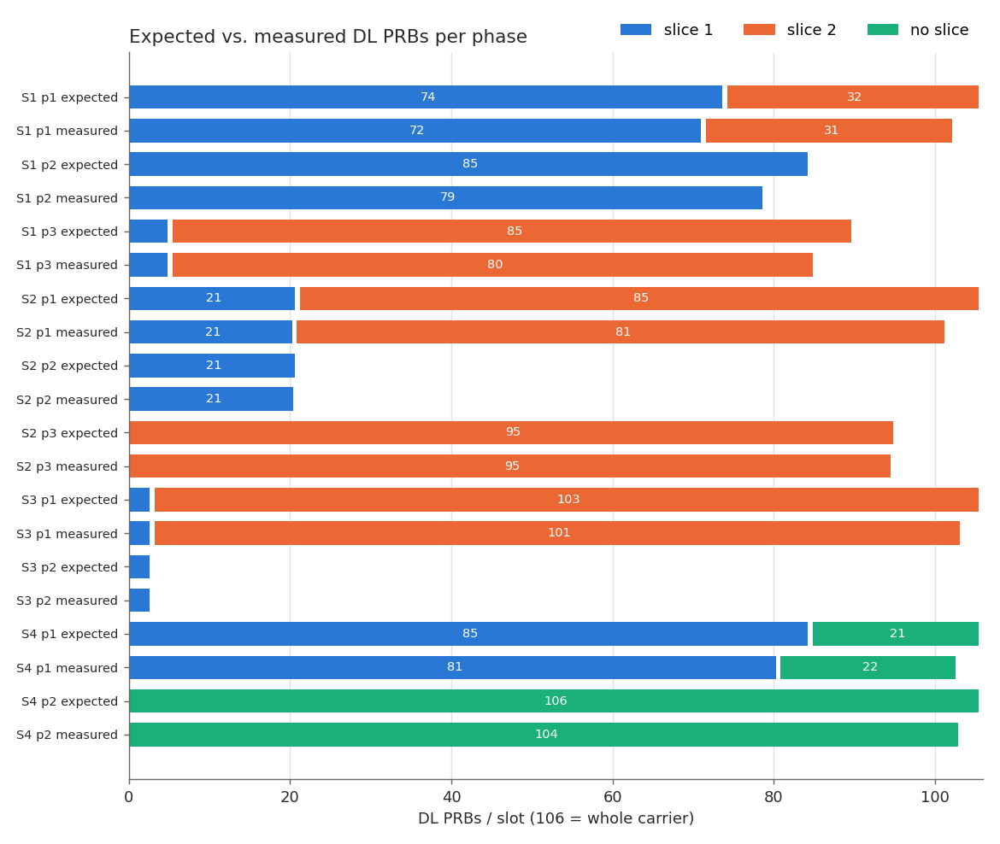
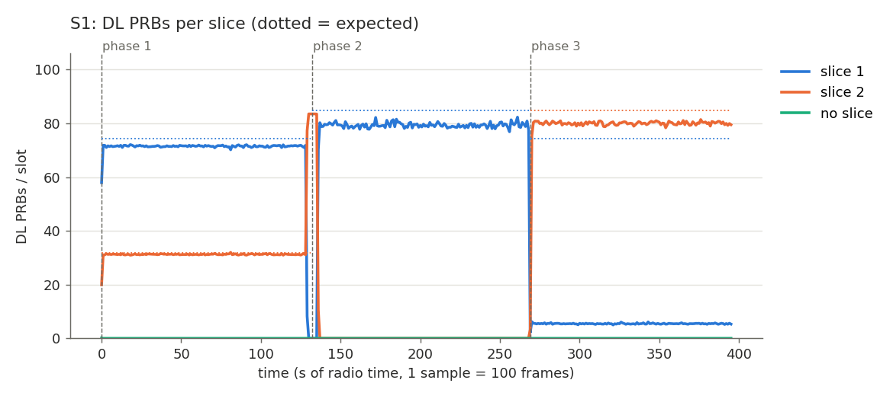
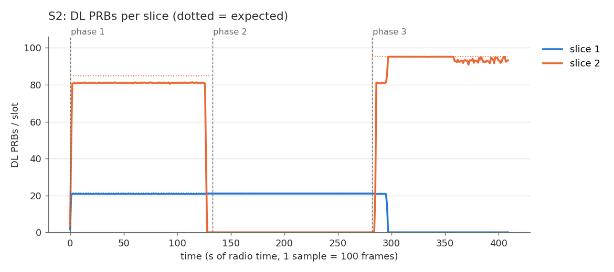
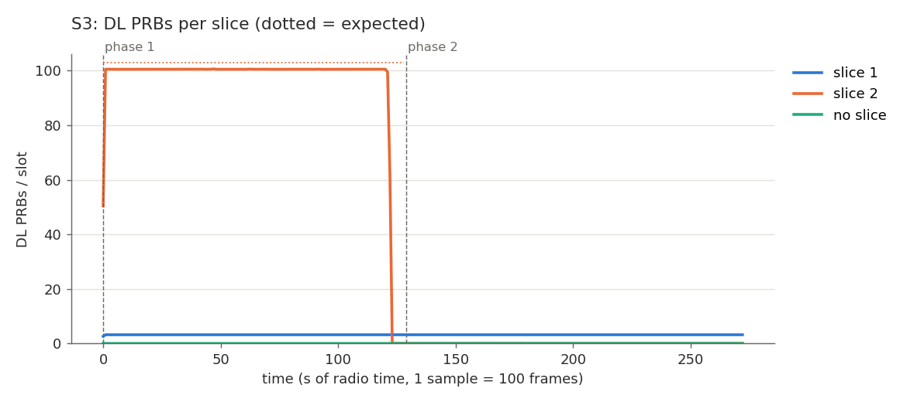
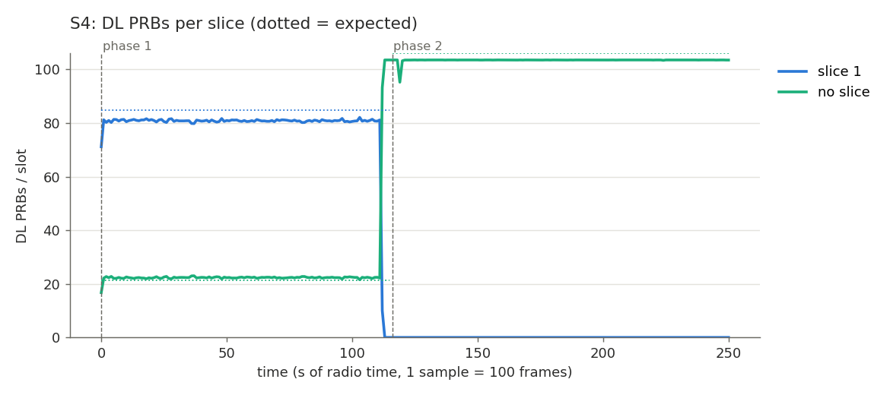
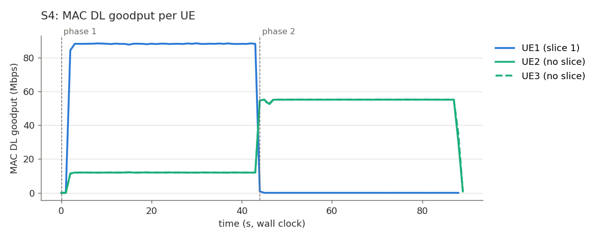

# RAN Slicing in the OAI gNB MAC — NC State - Farzad and Corbin

---

## 1. Test setup

### 1.1 One-time setup (repeat after a reboot)

```bash
docker compose -f sliced-cn.yaml up -d                      # sliced core network

cd tools/scripts
for i in 1 2 3; do sudo ./multi-ue.sh -c$i; done           # one network namespace per UE
for i in 1 2 3; do sudo firewall-cmd --zone=trusted --add-interface=v-eth$i; done
```

`run-scenario.sh` (below) also creates any missing namespace and firewall rule itself.

### 1.2 Build and run

```bash
cd build && ninja nr-softmodem nr-uesoftmodem

sudo ./nr-softmodem -O ../conf/gnb.conf 2>&1 | tee gnb.log
sudo ip netns exec ue1 ./nr-uesoftmodem -O ../conf/ue.conf  --rfsimulator.serveraddr 10.201.1.100
sudo ip netns exec ue2 ./nr-uesoftmodem -O ../conf/ue2.conf --rfsimulator.serveraddr 10.202.1.100
sudo ip netns exec ue3 ./nr-uesoftmodem -O ../conf/ue3.conf --rfsimulator.serveraddr 10.203.1.100
```

| UE | IMSI | S-NSSAI (SST / SD) | DNN | Slice |
|---|---|---|---|---|
| UE1 | 001010000000101 | 1 / 0x1 | `oai` | slice 1 |
| UE2 | 001010000000102 | 1 / 0x2 | `oai.ipv4` | slice 2 |
| UE3 | 001010000000103 | 1 / 0x2 | `oai.ipv4` | slice 2 (**no slice** in `gnb4.conf`) |

`gnb4.conf` configures only the SD 0x1 slice. UE2 and UE3 still register with SD 0x2, which the
core and the gNB's `plmn_list` accept, but no `slicing` policy matches it. Both therefore get
default (no-slice) scheduling.

### 1.3 Measurement method

| Metric | Source |
|---|---|
| **PRBs/slot per slice** | `DL slice N PRBs: X in Y slots` in the gNB log (once per 100 frames) |
| MAC goodput per UE | `nrMAC_stats.log`, sampled every second |
| iperf3 Mbps per UE | UDP server log in each UE namespace |

PRBs/slot is the primary metric because it is counted per slot. rfsim doesn't run in real time, so
wall-clock Mbps can't be trusted in absolute terms.

### 1.4 Running a scenario

```bash
cd scripts-oai
sudo ./run-scenario.sh S1       # or S2, S3, S4 – stops any running gNB/UE first
sudo ./run-all.sh               # S1..S4 back to back (~20 min), then analyze.py
python3 analyze.py              # tables -> results/summary.md, figures -> plots/
```

`run-scenario.sh` does the following:
1. starts the gNB with the scenario's config,
2. attaches the UEs one by one, each in its own namespace,
3. offers DL UDP traffic in **phases** of 40 s; a different set of UEs is loaded in each phase,
4. writes everything to `scripts-oai/results/<S>/`.

`analyze.py` drops the first 5 samples of each phase and takes the median of the rest; the median
ignores the ramp-up and drain edges of a phase. It compares each slice
with its expected **PRB budget**, which it computes with a model of the scheduler in `slicing.c`.

---

## 2. Scenarios

Ratios are written as dedicated/min/max in % of the 106-PRB carrier. Offered loads are iperf3 UDP
rates (wall clock).

| ID | gNB config | Policies (ded/min/max) | Phases (offered DL: UE1 / UE2 / UE3) | Shows |
|---|---|---|---|---|
| S1 | `gnb.conf` | slice 1 10/70/80, slice 2 10/30/80 | p1 250M/60M/60M · p2 250M/0/0 · p3 15M/125M/125M | **min** split, **max** cap, min ≠ dedicated |
| S2 | `gnb2.conf` | slice 1 10/15/20, slice 2 10/15/100 | p1 100M/125M/125M · p2 100M/0/0 · p3 0/140M/140M | **max** cap on an empty cell, **dedicated** |
| S3 | `gnb3.conf` | slice 1 0/3/3, slice 2 0/10/100 | p1 15M/150M/150M · p2 15M/0/0 | ratios **finer than 5 %** |
| S4 | `gnb4.conf` | slice 1 0/60/100 only; UE2, UE3 have no slice | p1 300M/60M/60M · p2 0/200M/200M | **UEs without a slice** (default scheduling) |

### 2.1 Expected vs. measured (DL PRBs/slot)

The expected value is the slice's long-run PRB budget from the scheduler model. The measured value
is the median per phase. Percentages are of the full 106-PRB carrier.

| Scenario / phase | Slice 1 exp. | Slice 1 meas. | Slice 2 / no-slice exp. | Slice 2 / no-slice meas. | Verdict |
|---|---|---|---|---|---|
| S1 p1 – all loaded | 74.2 (70 %) | **71.5** (67 %) | 31.8 (30 %) | **31.2** (29 %) | min split holds: 70 / 30 of used PRBs |
| S1 p2 – UE1 only | 84.8 (80 % max) | **79.2** (75 %) | idle | 0 | stays under max (UE1 not saturated†) |
| S1 p3 – UE1 at 15M | demand | **5.4** (5 %) | 84.8 (80 % max) | **80.1** (76 %) | slice 1's unused min goes to slice 2 |
| S2 p1 – all loaded | 21.2 (20 % max) | **20.9** (20 %) | 84.8 | **80.9** (76 %) | max cap holds |
| S2 p2 – UE1 only | 21.2 (20 % max) | **21.0** (20 %) | idle | 0 | max cap holds on an empty cell |
| S2 p3 – slice 2 only | idle (10 % ded.) | 0 | 95.4 (90 %) | **95.1** (90 %) | dedicated 10 % of idle slice kept |
| S3 p1 – all loaded | 3.18 (3 %) | **3.2** (3 %) | 102.8 | **100.5** (95 %) | 3 % slice served exactly |
| S3 p2 – UE1 only | 3.18 (3 % max) | **3.2** (3 %) | idle | 0 | 3 % max holds on an empty cell |
| S4 p1 – all loaded | 84.8 (80 %) | **80.8** (76 %) | no slice 21.2 (20 %) | **22.3** (21 %) | no-slice UEs get only the unreserved share |
| S4 p2 – UE1 idle | idle | 0 | no slice 106 (100 %) | **103.5** (98 %) | no-slice UEs get the whole usable carrier |

† iperf delivered ≈ 100 % of the offered rate in this phase, so the UEs were demand-limited and
used less than their budget (see 2.3).



Per-UE iperf and MAC goodput numbers are in `scripts-oai/results/summary.md`.

### 2.2 What each scenario demonstrates

**S1 – min, max, and why min is not dedicated** (`gnb.conf`)
- **p1:** both slices are loaded. The two min ratios add up to 100 %, so nothing is left to share
  and each slice gets exactly its min: 74.2 / 31.8 RBs.
- **p2:** only UE1 is loaded. Slice 1 could take 95 RBs (everything except slice 2's 10 %
  dedicated part), but its **max of 80 %** caps it at 84.8.
- **p3:** UE1 needs only a few RBs. Slice 1 keeps just its 10 % *dedicated* part blocked. The rest
  of its 70 % *min* flows to slice 2, up to slice 2's 80 % max. That is the difference between a
  min and a dedicated reservation.

**S2 – max is a hard cap; dedicated is never shared** (`gnb2.conf`)
- **p1:** slice 1's budget would be 15.9 + 74.2/2 ≈ 53 RBs, but its max caps it at 21.2 (20 %).
- **p2:** even with the rest of the cell empty, slice 1 stays at 21.2.
- **p3:** slice 1 is idle, so only its **dedicated 10 %** is kept and slice 2 tops out at 95.4
  (90 %), not 106.

**S3 – ratios finer than 5 %** (`gnb3.conf`)
- 3 % of 106 is 3.18 RBs, which is below PF's 5-RB minimum allocation. Without the credit mechanism
  slice 1 would never be scheduled.
- With the credit, the unspent entitlement carries over to the next slot. Slice 1 is served in
  ≥ 5-RB bursts, and its average should land at 3.18 PRBs/slot.
- In p2 the max (also 3 %) holds even though the cell is otherwise empty.

**S4 – UEs without a slice** (`gnb4.conf`)
- Only slice 1 (SD 0x1, 0/60/100) is configured. UE2 and UE3 (SD 0x2) fall into the *no-slice*
  group: no reservation, 100 % max, scheduled last with plain PF.
- **p1:** slice 1 reserves 63.6 RBs. The remaining 42.4 are split equally between slice 1 and the
  no-slice group, so slice 1 gets 84.8 and UE2 + UE3 share 21.2 (~10.6 each). Plain PF without
  slicing would give each UE about a third of the cell.
- **p2:** slice 1 is idle and has no dedicated part, so the no-slice UEs can use the whole carrier.

### 2.3 Results and analysis

**S1 – min / max / min ≠ dedicated**



- **p1:** the PRBs split 71.5 / 31.2, i.e. **69.6 % / 30.4 % of the PRBs used**, matching the
  70 / 30 min ratios. Our earlier iperf-only measurement (63/37) was distorted by rfsim timing;
  per-slot PRB counts don't have that problem. The two slices together use ~103 of 106 PRBs, which
  is all the carrier delivers in this setup (see the measurement notes).
- **p2:** UE1 alone stays below the 80 % max (79.2 PRBs/slot).
- **p3:** UE1 needs only 5.4 PRBs/slot, and slice 2 jumps from 31 to 80 PRBs/slot, right under its
  80 % max. The 70 % min of slice 1 is *not* blocked when unused; only the dedicated part would be.
- Between phases, the short spike of slice 2 to 84 PRBs/slot is the moment UE1's iperf had already
  ended and UE2/UE3's had not. Slice 2 alone immediately hits its 80 % max (84.8).

**S2 – max is a hard cap, dedicated is never shared**



- **p1–p2:** slice 1 is flat at **20.9–21.0 PRBs/slot = 20 %**, whether slice 2 is loaded or the
  cell is otherwise empty. iperf confirms it: UE1 was offered 100M and received only 57–65M.
- **p3:** slice 1 still drains its RLC queue for a few seconds (slice 2 sits at 81 meanwhile).
  Then slice 2 levels at **95.1 PRBs/slot = 90 %**: slice 1's 10 % dedicated part stays reserved
  even though slice 1 has nothing to send.

**S3 – ratios finer than 5 %**



- Slice 1 averages **3.2 PRBs/slot = 3.0 %** of the carrier in both phases. That is below PF's
  5-RB minimum allocation, so it only works because of the carried credit: slice 1 is served in
  ≥ 5-RB allocations in only a fraction of the slots.
- In p2 the cell is otherwise empty and slice 1 still stays at 3 %: the 3 % max holds. iperf
  confirms it: UE1 was offered 15M and received ~8M.

**S4 – UEs without a slice**





- The gNB log confirms the mapping: UE1 → `DL slice 1`; UE2 and UE3 → `DL slice 0` (no slice).
- **p1:** slice 1 gets **80.8 PRBs/slot (76 %)** and the two unsliced UEs share **22.3 (21 %)**,
  about 11 PRBs/slot each. Without slicing, PF would have given every UE about a third of the
  cell. UE1 was saturated (iperf received 134M of the 300M offered). It used ~4 PRBs/slot less than
  its 84.8 budget, and the no-slice group, which is scheduled last, picked up that remainder.
- **p2:** slice 1 goes idle and has no dedicated part. The no-slice UEs immediately take
  **103.5 PRBs/slot** and split it evenly; MAC goodput is 55 Mbps each.

**Measurement notes**
- rfsim ran ~3× faster than real time: a 40 s phase spans ~130 radio seconds of log samples. iperf
  rates (wall clock) and MAC goodput (radio time) therefore differ by about that factor. Only the
  PRB counts and ratios are compared.
- **Usable carrier ≈ 103.5 PRBs/slot, not 106.** S4 p2 had saturated UEs and no slicing limit,
  and it topped out at 103.5. S1 p1 (102.7 in total) and S3 p1 (103.7) hit the same ceiling. We
  didn't investigate the missing ~2.5 PRBs/slot; common channels (SSB, SIB1, CORESET) occupying
  RBs in some slots are a likely candidate. Budgets are computed from 106, so a saturated slice
  can fall a few PRBs short of its budget (S1 p1, S4 p1).
- Measured PRBs never exceed a slice's budget. In S1 p2, S1 p3 and S3 p1 (slice 2), iperf received
  ≈ 100 % of what was offered, so those UEs were also demand-limited. Higher offered loads would
  bring them closer to the budget.

---

## 3. Challenges

1. **Several UEs on one host.** Several `nr-uesoftmodem` instances on the same host collided:
   - each one creates `oaitun_ue1`,
   - they compete for ports,
   - the rfsim client failed with the assertion `t->sock >= 0`.

   **Fix:** we ran each UE in its own **network namespace** using OAI's
   `tools/scripts/multi-ue.sh -c<N>`. Namespace `ueN` reaches the gNB's rfsim server at
   `10.20N.1.100`.
2. **firewalld blocked the namespaces.** TCP 4043 (rfsim) from the namespaces was rejected with
   `errno 113` (no route to host). **Fix:** add each `v-ethN` to the `trusted` zone. This has to be
   redone after every firewalld reload.
3. **UE carrier frequency overflow.** `C = 3619200000` overflows a 32-bit integer and causes
   "Undefined Frequency Range". **Fix:** write it as `3619200000L`.
4. **rfsim is not real time.** iperf throughput is measured in wall-clock time, so absolute Mbps
   can't be trusted. We switched to **PRBs/slot** (counted per slot) and MAC goodput, and only
   compare ratios from iperf.
5. **Overloading the UEs.** At 300 Mbit/s, RLC AM queues filled, iperf's TCP control broke, and
   RLC retransmissions used up PRBs. **Fix:** offer about 1.2–2× the expected rate.
6. **PF minimum allocation.** DL PF allocates ≥ 5 RBs and asserts on smaller budgets, so small
   ratios got 0 PRBs. **Fix:** a budget guard, plus a credit that carries a slice's unspent
   entitlement over to the next slot.

## 4. AI tools used

- Claude Code Opus 5.5 (Anthropic) helped with:
  - code navigation,
  - debugging the multi-UE and firewall setup,
  - the test and measurement scripts,
  - drafting this README.

## 5. Plots

Generated by `scripts-oai/analyze.py` into `scripts-oai/plots/`:

- `overview.png`: expected vs. measured PRB split for every scenario phase.
- `S<n>_prbs.png`: DL PRBs/slot per slice over time (1 sample = 100 frames), with phase
  boundaries and expected budgets (dotted).
- `S<n>_goodput.png`: MAC DL goodput per UE over time.
